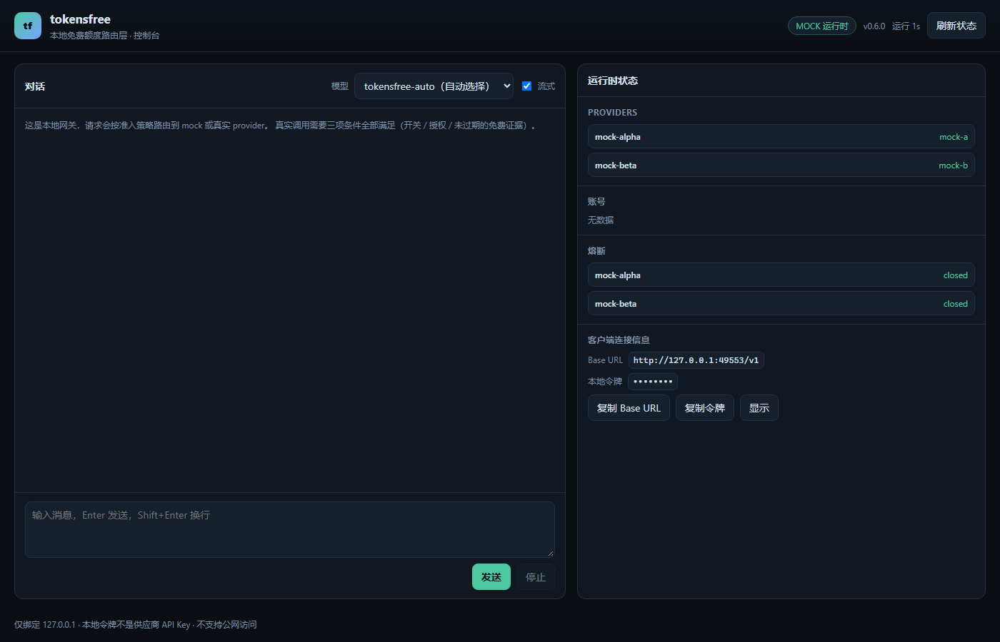
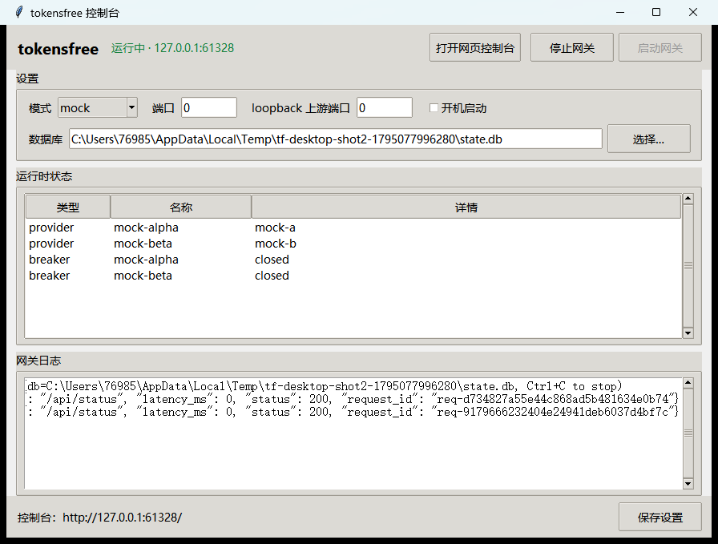

# tokensfree · 本地免费额度路由网关

把免费或自有的 OpenAI 兼容上游，统一暴露成 `127.0.0.1` 上的一个端点：
准入闸门、免费证据、熔断、账号与账本、mock 运行时、网页控制台与 Windows 桌面外壳。

- **运行时零第三方依赖**：只用 Python 标准库（asyncio / http.client / sqlite3 / hmac）。
- **默认零外发**：mock 运行时不需要任何 key；真实调用必须显式开启并满足准入条件。
- **密钥隔离**：供应商 key 只存 Windows 凭据管理器（或 CLI 的 key 文件），不进配置、日志、页面。

## 30 秒开始（Windows）

```powershell
.\scripts\quickstart.ps1
```

它会创建 `.venv`、生成含本地令牌的 `.env`（已 gitignore），然后启动网关。
打开 **<http://127.0.0.1:8766/>** 即可对话（默认 mock 模型）；`Ctrl+C` 停止。

之后再次启动：

```powershell
.\scripts\start.ps1
```

### 其他平台 / 手动启动

```bash
python3 -m venv .venv && . .venv/bin/activate
TOKENSFREE_LOCAL_TOKEN="$(python -c 'import secrets;print(secrets.token_urlsafe(32))')" \
  python -m tokensfree --port 8766 --db .tokensfree/state.db
```

> 本地令牌是**访问本机网关的凭证**（不是任何供应商的 API Key），长度 32–128，字符集 `[A-Za-z0-9_-]`。
> 支持 `--env-file .env` 读取 `TOKENSFREE_*` 变量；真实环境变量优先。

## 界面预览

| 网页控制台 | Windows 桌面面板 |
|---|---|
|  |  |

网页控制台：对话/流式、模型与通道状态、连接信息、接入通道管理（`--profiles` 启动后可用）。
桌面面板：启停网关、打开网页控制台、模式/端口/数据库设置、运行状态与日志、接入通道页与系统托盘。
## 能做什么

| 能力 | 入口 |
|---|---|
| 对话、流式、状态/账号/熔断、连接信息 | 网页控制台 `/` |
| 增删改/测试自定义通道、凭据写入 | 桌面端"接入通道"页；网页端（需 `--profiles` 启动） |
| 接入本机 Ollama / LM Studio / vLLM、远端 HTTPS、自有 token | `providers.json` 或桌面/网页表单 |
| 让 DSH / 任意 OpenAI SDK 使用 | `base_url=http://127.0.0.1:8766/v1`，api key=本地令牌 |
| 桌面快捷方式/开机启动/托盘 | `install\install.ps1 [-Autostart]` |

安全默认：默认 mock；真实调用需要 `TOKENSFREE_ENABLE_REAL=1`、渠道授权与未过期的免费证据。
成本策略有三档：`free_verified`（需证据）、`zero_cost_local`（自有算力）、`user_paid`（默认禁止，需 `TOKENSFREE_ALLOW_USER_PAID=1` 显式开启）。

## 接入自己的通道（三步）

1. 启动桌面端：`.venv\Scripts\python -m tokensfree.desktop`，在 **接入通道** 页新增通道并点 **测试连接**
2. 回到 **控制面板**，模式选 `profiles`，点 **启动网关**
3. 网页控制台选择该模型开始对话；或把客户端的 `base_url` 指到 `http://127.0.0.1:8766/v1`

CLI 等价方式：

```powershell
$env:TOKENSFREE_ENABLE_REAL = "1"
.venv\Scripts\python -m tokensfree --check --profiles .\providers.json
.venv\Scripts\python -m tokensfree --profiles .\providers.json --port 8766 --db .\tokensfree.db
```

`providers.json` 示例、三种策略的约束、网页/桌面操作细节见 **[操作手册](docs/operator-guide.md)**。
智谱免费额度的实测记录见 **[docs/providers/zhipu.md](docs/providers/zhipu.md)**。

## 桌面端

```powershell
.venv\Scripts\python -m tokensfree.desktop          # 打开面板
powershell -ExecutionPolicy Bypass -File install\install.ps1              # 安装快捷方式
powershell -ExecutionPolicy Bypass -File install\install.ps1 -Autostart   # 开机启动（自动启网关）
powershell -ExecutionPolicy Bypass -File install\uninstall.ps1 [-RemoveData]
```

关闭窗口默认最小化到托盘；托盘菜单可显示面板、打开网页控制台、启停网关、退出。
配置在 `%APPDATA%\tokensfree\desktop.json`，通道在 `%APPDATA%\tokensfree\providers.json`。

## 开发与验证

```powershell
.venv\Scripts\pip install -r requirements-dev.txt   # 只用于开发/测试
.venv\Scripts\python scripts\verify_p0.py           # 全量门禁：ruff + pytest + 契约 + import guard + journey + secret scan
.venv\Scripts\python scripts\real_probe.py --help   # 真实上游探针（需免费证据与 key）
.venv\Scripts\python scripts\dsh_smoke.py --help    # DSH 契约冒烟
```

门禁以命令输出为准；当前版本号见 `python -m tokensfree --version`。

## 项目结构

```text
tokensfree/            网关包：edge 服务/路由/store/adapters、web 控制台、Windows 桌面端、接入通道模型
providers.py 等        共享核心：供应商契约、协议、凭据（早期实验核心，仍被网关复用）
scripts/               启动、门禁、凭据、证据快照、探针
install/               Windows 安装/卸载（用户级快捷方式）
tests/                 pytest 套件
docs/                  操作手册、供应商实测记录
```

## 安全边界

- 只绑定 `127.0.0.1`，默认拒绝非本机 Host/Origin；**不要**反向代理或暴露公网。
- 供应商 key 只存 Windows 凭据管理器（`tokensfree/<通道 id>/env-key`），只写不读回页面。
- 默认零账单：`user_paid` 通道默认拒绝，需要你显式开启并自行承担费用。
- 真实调用 = `TOKENSFREE_ENABLE_REAL=1` + 授权通道 + 未过期免费证据；任一不满足即拒绝，不会静默降级。

## 许可证

Apache-2.0，见 [LICENSE](LICENSE)。变更记录见 [CHANGELOG.md](CHANGELOG.md)。
